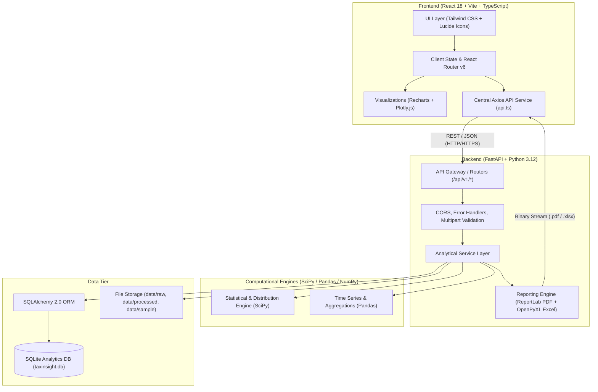

# TaxInsight – System Architecture Document (ARCHITECTURE.md)

## 1. System Architecture Overview

TaxInsight is architected as a decoupled, high-performance web platform combining a modern React single-page application (SPA) with a high-throughput Python FastAPI backend and an embedded, reproducible SQLite analytical database.



---

## 2. Layered Component Responsibilities

### 2.1 Frontend Architecture (`frontend/`)
- **Framework**: React 18 with Vite bundler and TypeScript.
- **Styling**: Tailwind CSS with custom theme variables matching Indian macroeconomic and institutional palettes (Navy, Saffron accents, Slate neutrals).
- **Navigation**: `react-router-dom` v6 with deep-linking across 8 distinct module views:
  1. `/` or `/overview`: Executive Overview dashboard.
  2. `/revenue`: Revenue Decomposition & Growth Analytics.
  3. `/regional`: State/UT Regional Intelligence & Concentration.
  4. `/itr`: ITR Form Distribution & Filer Demographics.
  5. `/statistics`: Distribution Fitting, Lorenz Curve & Inequality Metrics.
  6. `/data-quality`: Completeness, Discrepancies & Reconciliation.
  7. `/datasets`: File Upload, Validation & Dataset Management.
  8. `/reports`: On-demand PDF & Excel Export Studio.
- **Visualization Strategy**:
  - **Recharts**: Responsive SVG line, area, bar, and donut charts for time series, composition breakdowns, and regional rankings.
  - **Plotly.js**: Advanced scientific plotting including Lorenz curves, empirical cumulative distribution functions (ECDF), and 3D/scatter distributions.
- **Service Layer**: Single unified Axios instance configured with timeout safeguards, error normalization, and reactive progress tracking for file uploads.

### 2.2 Backend Architecture (`backend/`)
- **Framework**: FastAPI (ASGI) running on Uvicorn.
- **Layer Structure**:
  - `app/api/routes/`: Route declarations separated by module domain:
    - `dashboard.py`: Summary KPIs and executive overviews.
    - `analytics.py`: Revenue, regional, ITR, statistical, and data quality endpoints.
    - `datasets.py`: Upload handler, dataset list, preview, and process staging.
    - `reports.py`: PDF (ReportLab) and Excel (OpenPyXL) binary generators.
  - `app/core/`: Configuration management (`config.py`) via Pydantic Settings, environment parsing, and CORS policy enforcement.
  - `app/database/`: SQLAlchemy engine, thread-safe session factories, declarative model registry, and seeders.
  - `app/models/`: SQLAlchemy ORM entity models for collections, states, ITR filers, income slabs, and dataset audit registries.
  - `app/schemas/`: Pydantic v2 validation models defining strict request/response data shapes adhering to `API_CONTRACT.md`.
  - `app/services/`: Pure business logic decoupled from HTTP transport:
    - `revenue_service.py`: Growth rates, buoyancy factors, CIT vs. PIT ratios.
    - `regional_service.py`: State aggregations, zonal breakdowns, concentration indices.
    - `itr_service.py`: Form type distributions, entity classification.
    - `statistical_service.py`: SciPy statistical moments (mean, std, skewness, kurtosis), Lorenz curve generation, Gini coefficient computation.
    - `data_quality_service.py`: Integrity validation, missing value auditing, discrepancy checks.
    - `dataset_service.py`: Multipart file security, MIME checking, schema validation, CSV/Excel parsing.
    - `report_service.py`: ReportLab document building (flowable tables, styled canvas) and OpenPyXL workbook formatting.

---

## 3. Data Tier & Ingestion Pipeline

```
Raw CBDT Statistics (.csv / .xlsx)
          │
          ▼
   Security & Schema Audit (MIME validation, size limit <15MB, header check)
          │
          ▼
   Staging & Ingestion Service (Type coercion, Null preservation)
          │
          ▼
   SQLite Database (Normalized tables via SQLAlchemy)
          │
          ▼
   Analytical Computation (Pandas / NumPy / SciPy aggregations)
          │
          ▼
   FastAPI Response Schemas (Pydantic serialization)
```

---

## 4. Production Deployment Strategy
- **Frontend Hosting (Vercel)**:
  - Output directory: `frontend/dist`
  - Build command: `npm run build`
  - Single-page application route rewrite rules configured via `frontend/vercel.json`.
- **Backend Hosting (Render)**:
  - Environment: Python 3
  - Build command: `pip install -r requirements.txt`
  - Start command: `uvicorn app.main:app --host 0.0.0.0 --port $PORT`
  - Root directory set to `backend` or execution via Render blueprint `render.yaml`.

