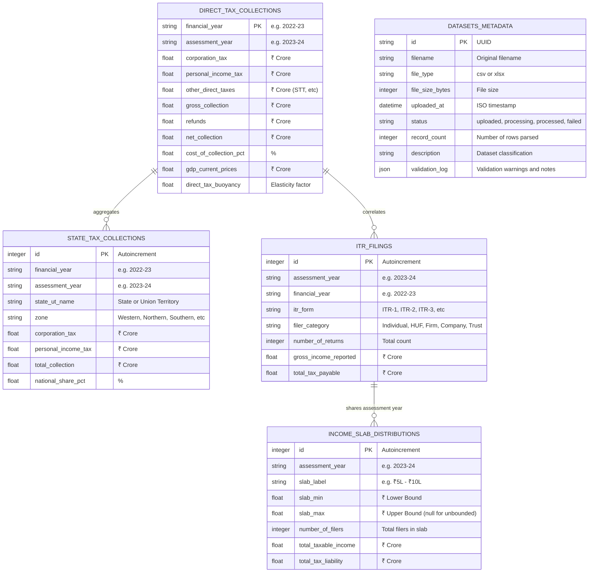

# TaxInsight – Database Schema Specification (DATABASE_SCHEMA.md)

## 1. Entity-Relationship Overview

TaxInsight utilizes an analytical relational model implemented in SQLite via SQLAlchemy 2.0 ORM. The schema is organized into time series collections, geographical distributions, taxpayer form categorizations, income slab moments, and dataset upload audit trails.

---

## 2. Table Schemas & Data Constraints

### 2.1 Table: `direct_tax_collections`
Captures national macro-level time series data released by CBDT.
- **Primary Key**: `financial_year` (VARCHAR(10))
- **Index**: `assessment_year` (VARCHAR(10))

| Column | Type | Nullable | Description & Constraints |
| :--- | :--- | :--- | :--- |
| `financial_year` | VARCHAR(10) | No | Financial year of collection (Format: `YYYY-YY`, e.g., `2022-23`) |
| `assessment_year` | VARCHAR(10) | No | Corresponding assessment year (Format: `YYYY-YY`, e.g., `2023-24`) |
| `corporation_tax` | FLOAT | No | Total Corporate Income Tax collected (₹ Crore) |
| `personal_income_tax` | FLOAT | No | Total Personal Income Tax collected (₹ Crore) |
| `other_direct_taxes` | FLOAT | Yes | Securities Transaction Tax, Equalisation Levy, Wealth Tax (₹ Crore) |
| `gross_collection` | FLOAT | No | Gross collections before refund deductions (₹ Crore) |
| `refunds` | FLOAT | No | Total tax refunds issued during the fiscal year (₹ Crore) |
| `net_collection` | FLOAT | No | Net Direct Tax Collection: `gross_collection - refunds` (₹ Crore) |
| `cost_of_collection_pct`| FLOAT | Yes | Cost incurred by ITD per ₹100 of tax collected (%) |
| `gdp_current_prices` | FLOAT | Yes | Nominal GDP at current market prices (₹ Crore) |
| `direct_tax_buoyancy` | FLOAT | Yes | Buoyancy coefficient relative to nominal GDP growth |

### 2.2 Table: `state_tax_collections`
Captures direct tax collections disaggregated across Indian States and Union Territories.
- **Primary Key**: `id` (INTEGER, AUTOINCREMENT)
- **Composite Unique Index**: `(financial_year, state_ut_name)`

| Column | Type | Nullable | Description & Constraints |
| :--- | :--- | :--- | :--- |
| `id` | INTEGER | No | Unique surrogate key |
| `financial_year` | VARCHAR(10) | No | Financial year (e.g., `2022-23`) |
| `assessment_year` | VARCHAR(10) | No | Assessment year (e.g., `2023-24`) |
| `state_ut_name` | VARCHAR(100)| No | Standardized state or UT name (e.g., `Maharashtra`, `Delhi`, `Karnataka`) |
| `zone` | VARCHAR(50) | No | Geo-administrative zone (`West`, `North`, `South`, `East`, `Central`, `North-East`) |
| `corporation_tax` | FLOAT | Yes | Corporation tax from state collection circles (₹ Crore) |
| `personal_income_tax` | FLOAT | Yes | Personal income tax from state collection circles (₹ Crore) |
| `total_collection` | FLOAT | No | Total state collection (₹ Crore) |
| `national_share_pct`| FLOAT | Yes | State contribution as a percentage of total national direct tax (%) |

### 2.3 Table: `itr_filings`
Filing volumes across statutory Indian Income Tax Return forms and taxpayer statuses.
- **Primary Key**: `id` (INTEGER, AUTOINCREMENT)
- **Composite Index**: `(assessment_year, itr_form, filer_category)`

| Column | Type | Nullable | Description & Constraints |
| :--- | :--- | :--- | :--- |
| `id` | INTEGER | No | Unique surrogate key |
| `assessment_year` | VARCHAR(10) | No | Assessment year of return filing (e.g., `2023-24`) |
| `financial_year` | VARCHAR(10) | No | Financial year of earned income (e.g., `2022-23`) |
| `itr_form` | VARCHAR(20) | No | Form designation (`ITR-1`, `ITR-2`, `ITR-3`, `ITR-4`, `ITR-5`, `ITR-6`, `ITR-7`) |
| `filer_category` | VARCHAR(50) | No | Filer legal status (`Individual`, `HUF`, `Firm`, `Company`, `AOP_BOI`, `Trust`) |
| `number_of_returns` | INTEGER | No | Count of successfully processed returns |
| `gross_income_reported`| FLOAT | Yes | Aggregate gross total income reported (₹ Crore) |
| `total_tax_payable`| FLOAT | Yes | Net aggregate tax payable computed (₹ Crore) |

### 2.4 Table: `income_slab_distributions`
Taxpayer population frequency distribution across standard taxable income brackets.
- **Primary Key**: `id` (INTEGER, AUTOINCREMENT)
- **Composite Index**: `(assessment_year, slab_label)`

| Column | Type | Nullable | Description & Constraints |
| :--- | :--- | :--- | :--- |
| `id` | INTEGER | No | Unique surrogate key |
| `assessment_year` | VARCHAR(10) | No | Assessment year |
| `slab_label` | VARCHAR(50) | No | Bracket display label (e.g., `₹5L - ₹10L`, `> ₹1 Crore`) |
| `slab_min` | FLOAT | No | Range lower bound in Rupees |
| `slab_max` | FLOAT | Yes | Range upper bound in Rupees (`NULL` represents unbounded top bracket) |
| `number_of_filers` | INTEGER | No | Number of taxpayers in this income bracket |
| `total_taxable_income`| FLOAT | No | Aggregate taxable income returned in this bracket (₹ Crore) |
| `total_tax_liability`| FLOAT | No | Aggregate tax liability generated by this bracket (₹ Crore) |

### 2.5 Table: `datasets_metadata`
Audit log and metadata registry for dataset files uploaded and processed by the system.
- **Primary Key**: `id` (VARCHAR(36), UUID)

| Column | Type | Nullable | Description & Constraints |
| :--- | :--- | :--- | :--- |
| `id` | VARCHAR(36) | No | Unique UUID string |
| `filename` | VARCHAR(255)| No | Original uploaded filename |
| `file_type` | VARCHAR(10) | No | `csv` or `xlsx` |
| `file_size_bytes`| INTEGER | No | Size in bytes (enforced $\le 15 \times 1024 \times 1024$) |
| `uploaded_at` | DATETIME | No | Upload timestamp (UTC) |
| `status` | VARCHAR(20) | No | `uploaded`, `processing`, `processed`, `failed` |
| `record_count` | INTEGER | Yes | Number of records successfully parsed |
| `description` | TEXT | Yes | Purpose and notes on the dataset |
| `validation_log`| TEXT (JSON) | Yes | Structured JSON log containing validation notes or error traces |
