# TaxInsight – Income Tax Data Analytics and Intelligence Dashboard

[](https://www.python.org/)
[](https://fastapi.tiangolo.com/)
[](https://react.dev/)
[](https://www.typescriptlang.org/)
[](https://tailwindcss.com/)
[](LICENSE)

**TaxInsight** is an enterprise-grade full-stack analytical platform engineered for deep exploratory analysis, visualization, and intelligence reporting on publicly available Indian direct tax statistics released by the Central Board of Direct Taxes (CBDT), Ministry of Finance, Government of India.

Designed for high-impact academic evaluation and professional portfolio demonstration, TaxInsight adheres to strict domain principles: accurate historical series, rigorous distinction between Financial Years (FY) and Assessment Years (AY), zero synthetic fabrication of real data, and full auditability of macro-level figures.

---

## 🏛️ Domain Concepts at a Glance

- **Financial Year (FY) vs. Assessment Year (AY)**:
  - **Financial Year (1 April – 31 March)**: The fiscal year in which income is earned.
  - **Assessment Year (1 April – 31 March next)**: The succeeding year in which returns are filed and assessed ($\text{AY} = \text{FY} + 1$).
- **Gross vs. Net Collections**:
  $$\text{Net Direct Tax} = \text{Gross Collection} - \text{Refunds Disbursed}$$
- **Direct Tax Composition**:
  - **Corporation Tax (CIT)**: Taxes paid by domestic and multinational corporate entities.
  - **Personal Income Tax (PIT)**: Direct taxes on individuals, HUFs, partnership firms, and associations.
  - **Other Direct Taxes**: Securities Transaction Tax (STT), Equalisation Levy.
- **Direct Tax Buoyancy**:
  $$\text{Tax Buoyancy} = \frac{\% \Delta \text{ Direct Tax Collection}}{\% \Delta \text{ Nominal GDP}}$$

---

## 🚀 Key Modules

1. **Executive Overview**: High-level macro KPIs, total collections, YoY trends, and Corporation vs. Personal Income Tax mix.
2. **Revenue Analytics**: Gross vs. Net collection trajectories, refund disbursal velocity, cost of collection efficiency, and GDP buoyancy factors.
3. **Regional Analytics**: State and Union Territory breakdown, geographical zonal aggregations, and national concentration metrics (Top 3 and Top 5 state shares).
4. **ITR Analytics**: Filing volume breakdowns by statutory return form (`ITR-1 Sahaj` through `ITR-7`) and legal taxpayer entities (Individual, HUF, Firm, Company, Trust).
5. **Statistical Analysis**: Empirical income bracket distribution, SciPy-calculated statistical moments (Skewness, Kurtosis), Lorenz curve generation, and Gini coefficient inequality index.
6. **Data Quality Intelligence**: Completeness scoring across fiscal years, Gross - Refunds = Net reconciliation checks, and outlier detection.
7. **Dataset Management**: Drag-and-drop CSV and Excel dataset upload, strict MIME and schema validation ($\le 15$ MB limit), and table preview.
8. **Automated Reporting**: Single-click on-demand generation of formal executive briefing PDFs (ReportLab) and multi-tab structured Excel workbooks (OpenPyXL).

---

## 🛠️ Architecture & Tech Stack

```mermaid
flowchart LR
    subgraph Frontend ["Frontend (Vercel Ready)"]
        React["React 18 + TypeScript"]
        Tailwind["Tailwind CSS + Lucide"]
        Charts["Recharts + Plotly.js"]
        Router["React Router v6"]
    end

    subgraph Backend ["Backend (Render Ready)"]
        FastAPI["FastAPI (Python 3.12)"]
        Pandas["Pandas & NumPy"]
        SciPy["SciPy Statistical Engine"]
        ReportLab["ReportLab PDF & OpenPyXL"]
    end

    subgraph Storage ["Persistence"]
        SQLAlchemy["SQLAlchemy 2.0 ORM"]
        SQLite[("SQLite (taxinsight.db)")]
    end

    Frontend -- "REST API (JSON / Envelope)" --> Backend
    Backend --> Storage
```



---

## 📂 Repository Structure

```
TaxinSight/
├── frontend/                     # React 18 + TypeScript + Vite SPA
│   ├── src/
│   │   ├── components/           # UI elements, charts, dashboard cards, filters
│   │   ├── pages/                # 8 module page views
│   │   ├── services/             # Axios API client (api.ts)
│   │   ├── types/                # TypeScript interface contracts
│   │   ├── App.tsx               # Route definitions
│   │   └── main.tsx              # DOM root mount
│   ├── package.json
│   ├── vite.config.ts
│   └── vercel.json               # Vercel deployment rewrite rules
├── backend/                      # Python FastAPI application
│   ├── app/
│   │   ├── api/routes/           # Modular route controllers
│   │   ├── core/                 # Settings, CORS, environment configs
│   │   ├── database/             # SQLAlchemy engine & seed data script
│   │   ├── models/               # SQLAlchemy ORM data models
│   │   ├── schemas/              # Pydantic v2 schemas
│   │   ├── services/             # Analytics, SciPy stats, PDF & Excel engines
│   │   └── main.py               # FastAPI application entry point
│   ├── tests/                    # Pytest test suite
│   ├── requirements.txt          # Pinned Python package dependencies
│   └── render.yaml               # Render cloud deployment blueprint
├── data/
│   ├── raw/                      # Unmodified official reference datasets
│   ├── processed/                # Normalized, validated tables
│   └── sample/                   # Seed files for local database initialization
├── docs/                         # Technical specifications and methodology
├── PROJECT_SPEC.md               # Master functional requirements
├── ARCHITECTURE.md               # System architectural design
├── DATABASE_SCHEMA.md            # Relational database models and constraints
├── API_CONTRACT.md               # REST API endpoints & payload contracts
├── DATA_DICTIONARY.md            # Tax domain terminology, units & citations
├── TASK_ASSIGNMENTS.md           # Multi-agent role matrix
├── IMPLEMENTATION_STATUS.md      # Live implementation milestone tracker
└── README.md                     # Project documentation
```

---

## ⚡ Quick Start & Local Execution

### 1. Prerequisites
- Python 3.10+ (Recommended: Python 3.12)
- Node.js 18+ (Recommended: Node.js 20+ LTS)

### 2. Backend Setup
```powershell
cd backend

# Create and activate virtual environment (Windows)
python -m venv .venv
.\.venv\Scripts\activate

# Install dependencies
pip install -r requirements.txt

# Run the FastAPI server
uvicorn app.main:app --reload --port 8000
```
- Interactive API Documentation (Swagger): [http://localhost:8000/docs](http://localhost:8000/docs)
- Alternative API Specs (ReDoc): [http://localhost:8000/redoc](http://localhost:8000/redoc)

### 3. Frontend Setup
```powershell
cd frontend

# Install npm dependencies
npm install

# Start Vite development server
npm run dev
```
- Access Frontend Application: [http://localhost:5173](http://localhost:5173)

---

## 🧪 Automated Testing
```powershell
cd backend
.\.venv\Scripts\pytest
```

---

## 🌐 Cloud Deployment

- **Frontend on Vercel**:
  - Connect your GitHub repository to Vercel.
  - Set **Root Directory** to `frontend`.
  - Framework Preset: `Vite`.
  - Add Environment Variable: `VITE_API_BASE_URL=<your-backend-render-url>`.
- **Backend on Render**:
  - Deploy as a **Web Service** using `backend/render.yaml` or Docker/Python environment.
  - Build Command: `pip install -r requirements.txt`.
  - Start Command: `uvicorn app.main:app --host 0.0.0.0 --port $PORT`.

---

## 📜 Citations & Official References
All baseline data is based on publicly available statistical reports released by the **Central Board of Direct Taxes (CBDT)**, Department of Revenue, Ministry of Finance, Government of India.
